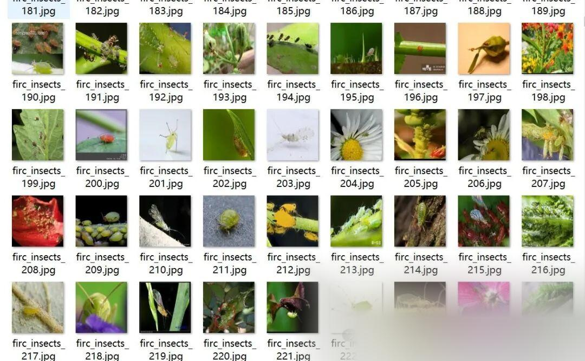
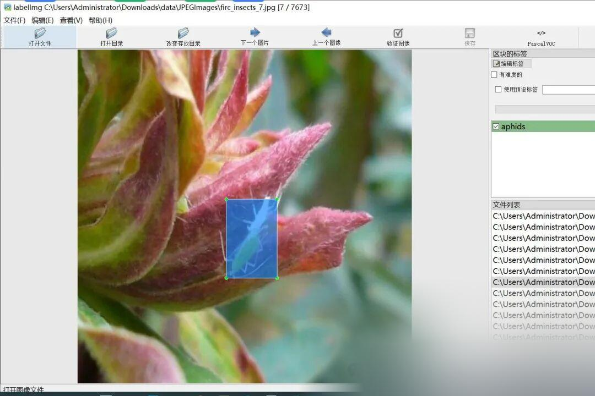

# Plant Pest and Disease Detection Dataset VOC+YOLO format with 7673 images in 9 categories

Dataset format: Pascal VOC format + YOLO format (txt file without split path, only containing jpg images and corresponding VOC format xml files and yolo format txt files)

Number of images (number of jpg files): 7673

Number of annotations (number of xml files): 7673

Number of annotations (number of txt files): 7673

Label category count: 9

Label category names (Note that the order of categories in the YOLO format does not correspond to this, but is based on the labels folder's classes.txt): ["aphids", "armyworms", "bees", "beetle", "ladybug", "locust", "moth", "weevil", "whitefly"]

Number of boxes labeled in each category:

Aphids frame count = 1298

armyworms Frame Count = 1065

Number of bees = 1022

Beetle frame count = 1105

Ladybug frame count = 1070

Locust frame count = 1164

Moth frame count = 1009

Weevil frame count = 1034

Whitefly frame count = 1378

Total frames: 10145

Using labelImg:

Annotation rules: Draw a rectangle around the category.

Important Notice: No

Special : This dataset does not guarantee the accuracy or precision of the trained models or weight files. The dataset is provided with accurate and reasonable annotations only.

Image Preview:

Annotation example:

## Payment

Here is a pay link on Stripe ( https://buy.stripe.com/3cs8yP7sY87d0vu9AB ). Please contact me lonlonago@foxmail.com after funding $89, and I will send you a complete data files , thank you!

